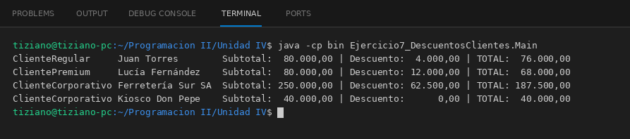

# Cliente

Programación II - Unidad 4 - Ejercicio 7

## Consigna
Calcular el precio final de una venta según el tipo de cliente, delegando el descuento en el objeto cliente.

## Lógica
- Clase abstracta `Cliente` (nombre, dni) con `double aplicarDescuento(double subtotal)`, que devuelve el monto a descontar.
- `ClienteRegular` 5 %, `ClientePremium` 15 % y `ClienteCorporativo` 25 % solo si la compra llega a 100 000.
- `Factura` recibe un `Cliente` y calcula `subtotal - descuento` sin usar `instanceof` ni condicionales por tipo.
- `Main`: cuatro clientes con distintos subtotales y el desglose de montos.

## Ejecución

